# 운영 워크플로우 — 하루 두 번 도는 카톡방 요약 파이프라인

> 이 스킬(kakao-wiki)은 실제로 매일 도는 **카카오톡 오픈채팅 요약 파이프라인**을 떼어 내 일반화한 것입니다. 이 문서는 그 원본 파이프라인이 **지금(2026-11 기준) 실제로 어떻게 도는지**를 보여 줍니다.
> - **사람이 읽을 것:** 아래 차트 한 장.
> - **AI 에이전트가 읽을 것:** 차트 아래 «단계별 명세». 언제, 무엇을 하고, 어떤 조건이면 통과·멈춤인지, 실패하면 어디로 가는지를 적었습니다. 운영 문서에 실패 경로가 정해져 있지 않은 곳은 «미정의»로 표시했습니다.
> - 기준: 문서와 실제 코드가 다르면 **코드**를 따랐습니다. 방 이름, 사람 이름, 계정, 내부 경로는 모두 뺐습니다.

## 차트

```mermaid
%%{init: {"flowchart": {"wrappingWidth": 320}}}%%
flowchart TD
  %% 카카오톡 오픈채팅 요약 파이프라인 — 하루 2회(아침판·저녁판)
  %% 실선 테두리 = 코드가 강제하는 단계 · 점선 테두리 = AI 작업 세션이 지시문·운영 절차 문서를 따라 하는 단계
  %% 묶음 이름 A~E 는 이 그림 안에서만 씀. 문서 아래 ①~⑩ 은 «단계별 명세» 번호
  %% 간략화한 그림: 세부 실패 경로는 아래 단계별 명세에 적음

  subgraph CLOCK["⏰ 예약 실행 (OS 스케줄러)"]
    direction LR
    AM["05:30 아침판 시작<br/>범위: 전날 저녁 이후 대화"]
    PM["17:35 저녁판 시작<br/>범위: 아침 이후 대화"]
  end

  subgraph TRIG["A. 시작 전 점검 — 트리거 스크립트"]
    G1{"오늘 이 회차<br/>건너뛰기 표시?"}
    G2{"같은 회차 중복?<br/>아침 = 30분 안에 이미 완료<br/>저녁 = 아직 실행 중(2분 대기 후 판정)"}
    G3{"AI 작업 세션이<br/>살아 있나?"}
    G4["아침판: 지시문 손상 검사<br/>400자 미만이면 넣지 않고 경보"]
    G5["세션 입력 막힘이면<br/>최대 10분 재판정"]
    G6["작업권 확보<br/>점유 중이면 30초 × 6회 재시도"]
    G7["진행 현황 스레드 개설<br/>단계 칸 미리 게시"]
    G8["지시문 넣기 + 접수 확인<br/>90초 안 미접수 → Enter 재전송"]
    G9["감시자 기동<br/>아침판 = 완료 감시 90분 상한<br/>공통 = 작업권 연장"]
  end

  AM --> G1
  PM --> G1
  G1 -- "예" --> SKIPALL["«건너뜀»으로 마감 기록만 남김"]
  G1 -- "아니오" --> G2
  G2 -- "예" --> QUIT["조용히 종료"]
  G2 -- "아니오" --> G3
  G3 -- "아니오" --> ALERT1["로그만 남기고 중단<br/>→ 10분 감시자가 경보"]
  G3 -- "예" --> G4 --> G5 --> G6 --> G7 --> G8 --> G9
  G4 -. "400자 미만" .-> STOPA["경보 후 종료"]
  G5 -. "10분 내내 막힘" .-> STOPA
  G6 -. "6회 모두 점유 중" .-> STOPA

  subgraph SESS["B. AI 작업 세션 — 수집 · 정리 · 요약"]
    S0{"사전 점검 — 점검 스크립트를 세션이 실행<br/>메신저 로그인 상태 · 읽는 계정 대조<br/>디스크 여유 · 동기화 30분 이내"}
    RPT["저녁판만: 대표 방 종합 보고서<br/>초안 = Sonnet 5.5 medium · 팩트체크 = Codex gpt-6-luna high<br/>인용 대조 게이트 · 품질 검증 6축 · 주제·분량 점검<br/>메시지 100건 미만이면 보고서 생략"]
    C1["방별 수집 — 공개 방 3곳<br/>범위 = 그 방 직전 성공 지점 ~ 지금<br/>메신저 로컬 DB 직접 읽기"]
    C1B["예비 경로<br/>메신저 화면 내보내기 → CSV"]
    CX["제외 목록 메시지 자동 제거"]
    C2{"정리 후<br/>60건 초과?"}
    C2N["그 방은 이번 회차 건너뜀<br/>범위 유지 → 다음 회차에 합산<br/>방에는 알리지 않음"]
    SUM["주제 군집 · 요약 — Sonnet 5.5 medium 서브에이전트<br/>익명판(위키용) + 실명판(카톡용) 두 벌<br/>인용은 원문 그대로 대조"]
    FC{"팩트체크 두 엔진 모두 통과<br/>Codex gpt-6-luna low + Sonnet 5.5 medium<br/>+ 문체 검사"}
    FCFIX["미통과 → 정정 후 다시 검사<br/>최대 2회"]
    FCX["2회 뒤에도 중대한 지적이 남으면<br/>이 요약은 발송하지 않음<br/>그 뒤 처리는 문서에 미정의"]
  end

  G9 --> S0
  S0 -- "이상" --> HOLD1["수집 · 발송 멈춤<br/>로그인 시도 안 함 → 운영자 알림"]
  S0 -- "정상 · 저녁판" --> RPT --> C1
  S0 -- "정상 · 아침판" --> C1
  C1 -- "DB 읽기 실패" --> C1B --> CX
  C1 -- "성공" --> CX
  C1 -- "방을 못 찾음" --> ALERT2["수집 불가 경보<br/>조용한 방으로 취급 안 함"]
  CX --> C2
  C2 -- "아니오" --> C2N
  C2 -- "예" --> SUM --> FC
  FC -- "미통과" --> FCFIX --> FC
  FC -. "정정 2회 소진" .-> FCX

  subgraph WIKI["C. 위키 에디션 발행"]
    W1["기사 집필 900자 이상 — 일반 = Sonnet 5.5 · 대표 기사 = AI 작업 세션(Opus 5.5)<br/>썸네일 = 썸네일 봇(gpt-6-luna) → 검수 봇 · 표지<br/>배경 설명 · 관련 기사 · AI 편집 검토 4건 · 중요도 정렬"]
    W2{"기사 검증 FAIL 0<br/>+ 에디션 게이트 G1~G21 exit 0?<br/>exit 7 = 운영자 확인 대기"}
    W3["사이트 빌드 · 서버 재기동<br/>→ 에디션 공개 전환"]
    W4["검색 색인 갱신<br/>실패해도 계속 · 자동 경보"]
    W5["쇼츠 영상 제작 — 문안 검수 봇 · 화면 봇<br/>→ 완성 관문(영상 + 품질 확인(QC) 이미지 없으면 발송 거부)"]
    WX["발송 금지 · 산출 보존<br/>운영자 알림<br/>정각 + 5시간 넘으면 다음 회차로 이월"]
  end

  FC -- "통과(남은 지적이 표현 강도 수준이면<br/>세션이 기록하고 종결)" --> W1 --> W2
  W2 -- "아니오" --> WX
  W2 -- "예" --> W3 --> W4 --> W5

  subgraph SEND["D. 카톡방 발송 — 방마다 차례로"]
    B1["발송 본문 조립 — 세션이 조립 스크립트를 호출<br/>실명판 기반 · 토픽마다 기사 링크<br/>방 열람 코드는 미리 계산만"]
    B2["정각 대기<br/>아침 07:00 · 저녁 19:00"]
    B3{"발송 관문 — 발송 래퍼가 코드로 검사<br/>본문 규격(3,950자 상한 등) · 건너뜀 표시 방 · 발송 금지 방<br/>발송 직전 계정 대조 · 제외어 · 승인 대기<br/>화면 잠금 · 쇼츠 완성"}
    B4{"메신저 DB에서<br/>도착 확인?"}
    B5["열람 코드 교체 확정<br/>→ 그 방에 쇼츠 영상 발송"]
    B6["확인 없이 재발송 금지 · 코드 유지<br/>기록 후 다음 방"]
    BX["보내지 않음<br/>사유 코드 기록"]
    BD["이미 같은 글이 있어 보내지 않음(종료 코드 0)<br/>열람 코드 교체는 «도착 확인» 출력이 있을 때만<br/>쇼츠 발송은 문서에 규정 없어 보수적으로 안 함"]
  end

  W5 --> B1 --> B2 --> B3
  B3 -- "통과" --> B4
  B3 -- "거부(종료 코드 1·4·5·6·7·8)" --> BX
  B3 -- "메신저 자동화 실패(종료 코드 2)" --> BX
  B3 -- "같은 전문이 이미 있음" --> BD
  B4 -- "예" --> B5
  B4 -- "미확인" --> B6

  subgraph CLOSE["E. 마감"]
    E1["요약 기록(원장)의 기준점을 앞으로 옮김<br/>보낸 방 = 범위 끝까지 · 건너뛴 방 = 유지"]
    E2{"회차 닫기<br/>상태 파일 · 원장이 이 회차를 가리키나?"}
    E3["검색 색인 점검 1줄"]
    E4["완료 보고 → 도착 검사<br/>누락이면 다시 보고"]
  end

  B5 --> E1
  B6 --> E1
  BX --> E1
  BD --> E1
  C2N --> E1
  E1 --> E2
  E2 -- "아니오" --> E2X["닫기 거부<br/>미완료로 판정"]
  E2 -- "예" --> E3 --> E4

  subgraph WATCH["🛡 상시 감시 · 보조 작업"]
    direction LR
    X1["10분마다 감시자<br/>세션이 꺼짐 · 입력 막힘 · 미완료<br/>지시문 12분 미접수 → 다시 넣기<br/>발송 시각 + 5분 기록 없음 → 발송 단계만 다시"]
    X2["2시간마다<br/>메신저 화면 권한 점검"]
    X3["15분마다<br/>기사 조회수 집계"]
    X4["5분마다<br/>진행 대시보드 갱신"]
    X5["항상 켜짐<br/>위키 서버 · 공개 터널<br/>공개 검색(검사 통과 때만 기동)"]
  end

  G9 -. "아침판 90분 넘도록 미완료" .-> ALERT3["완료 감시자 경보"]
  X1 -. "복구" .-> G8

  subgraph LEGEND["범례"]
    direction LR
    LG1["실선 파랑 = 코드가 강제"]
    LG2["점선 노랑 = AI 세션이 지시문을 따라 수행"]
    LG3["빨강 = 멈춤 · 거부 · 경보"]
    LG4["초록 = 상시 감시 · 보조 작업"]
  end

  classDef code fill:#e8f1ff,stroke:#2f6fd6,stroke-width:2px,color:#0b1f44
  classDef ai fill:#fff8e6,stroke:#c98a00,stroke-width:2px,stroke-dasharray:6 4,color:#3a2a00
  classDef stop fill:#fdecec,stroke:#c0392b,color:#4a0d07
  classDef bg fill:#eef7ee,stroke:#3c8d3c,color:#0f2e0f

  class AM,PM,G1,G2,G3,G4,G5,G6,G7,G8,G9,C1,C1B,CX,C2,C2N,W2,W3,B3,B4,E1,E2 code
  class S0,RPT,SUM,FC,FCFIX,W1,W4,W5,B1,B2,B5,E3,E4 ai
  class SKIPALL,QUIT,ALERT1,ALERT2,ALERT3,HOLD1,WX,B6,BX,BD,E2X,STOPA,FCX stop
  class X1,X2,X3,X4,X5,LG4 bg
  class LG1 code
  class LG2 ai
  class LG3 stop
```

**읽는 법**
- **파란 실선 칸**은 스크립트가 강제합니다. 조건을 못 넘으면 코드가 멈춥니다.
- **노란 점선 칸**은 AI 작업 세션이 지시문과 운영 절차 문서를 읽고 수행합니다. 지켜지지만 코드가 막아 주지는 않습니다.
- **빨간 칸**은 멈춤·거부·경보, **초록 칸**은 늘 도는 감시·보조 작업입니다.
- **번호 읽는 법:** 차트의 묶음 이름은 A~E, 문서 아래 «단계별 명세»의 번호는 ①~⑩ 입니다. 두 체계는 서로 다른 것이고, 문서 안의 «⑨ 발송 관문» 같은 참조는 모두 명세 번호입니다.
- **용어:** «원장»은 방마다 «어디까지 요약했는지» 적어 둔 기록입니다. «열람 코드»는 방마다 하나씩 있는 위키 페이지 열람용 짧은 코드로, 요약 메시지 맨 위에 실어 보냅니다. 이미 방에 나간 코드는 회수할 수 없으므로, 새 코드로 바꾸는 일은 «되돌릴 수 없는 동작»입니다.
- 실무에서 가장 쓸모 있는 구분은 «무엇을 코드가 막고, 무엇을 지시에 맡겼나»입니다. 원본 파이프라인은 **되돌릴 수 없는 일(카톡 발송)의 바로 앞**에 코드 게이트를 몰아 두었습니다.

---

## 한 줄 요약

예약 스크립트는 **일을 직접 하지 않습니다.** 점검만 하고, 늘 켜져 있는 AI 작업 세션에 «이번 회차 지시문»을 넣은 뒤 접수됐는지 확인하고 빠집니다. 수집부터 마감까지는 그 세션이 합니다. 코드는 1) 시작 전 점검 2) 위키 발행 게이트 3) 발송 관문 4) 마감 확인, 네 곳을 지킵니다.

## 시간표

| 시각 | 무엇 | 비고 |
|---|---|---|
| 05:30 | 아침판 시작 | 대상 = 방마다 «직전에 성공한 지점 ~ 지금» |
| 07:00 | 아침판 발송 | 준비가 일찍 끝나도 정각까지 기다림 · 늦으면 끝나는 즉시 보내고 지연 기록 |
| 17:35 | 저녁판 시작 | 저녁판에는 대표 방 종합 보고서 단계가 하나 더 있음 |
| 19:00 | 저녁판 발송 | 준비가 일찍 끝나도 정각까지 기다림 · 늦으면 끝나는 즉시 보내고 지연 기록 |
| 10분마다 | 감시자 | 세션이 꺼졌는지·입력이 막혔는지·미완료인지 감지, 지시문 다시 넣기 |
| 2시간마다 | 메신저 화면 제어 권한 점검 | 메신저 창이 하나도 안 잡히면 접근성 권한을 한 번 다시 설정하고 알림 |
| 15분 / 5분마다 | 기사 조회수 집계 / 진행 대시보드 갱신 | 실패해도 본 흐름에 영향 없음 |
| 항상 | 위키 서버 · 공개 터널 · 공개 검색 | 공개 검색은 색인 검사를 통과해야 기동 |

정각 대기(07:00 · 19:00)는 두 회차 모두 **지시문에만** 있고 코드가 막지는 않습니다.

---

## 누가 · 어떤 모델로 · 어떤 게이트를 (2026-11-04 실측)

원본 파이프라인은 일을 다섯 종류의 주체에게 나눕니다. 아래 «다른 에이전트» 행의 모델 이름은 실측 당시 값이며 바뀔 수 있습니다. 값은 실행 설정 파일과 실행 중 프로세스 인자에서 읽었고, 읽지 못한 칸은 «미확인»으로 두었습니다.

| 주체 | 모델 · 추론 강도(effort) | 호출 방식 | 맡는 일 |
|---|---|---|---|
| AI 작업 세션(상시) | Claude `claude-opus-5-5[1m]` · high | 터미널에 늘 켜 둔 Claude Code 세션. 예약 스크립트가 «이번 회차 지시문»을 넣는다 | 전 단계 진행 · 판정 · 정정 · 대표 기사 직접 집필 · 발송 본문 조립 · 완료 보고 |
| Sonnet 서브에이전트 | Claude `claude-sonnet-5-5[1m]` · medium (발송본 검수만 low) | AI 작업 세션이 서브에이전트로 띄움 | 보고서 초안 · 주제 군집 · 방별 리포트 · 일반 기사 · 품질 검증 · 팩트체크 한쪽 엔진 · AI 편집 검토 2건 |
| Codex | OpenAI `gpt-6-luna` · 래퍼 기본 high, 호출마다 low/medium 으로 덮어씀 | 격리 래퍼로 `codex exec` | 팩트체크 다른 쪽 엔진 · 주제·분량 점검 · AI 편집 검토 2건 |
| 스크립트 | LLM 없음 | python · shell · npm | 수집 · 건수 판정 · 모든 기계 게이트 · 발행 · 발송 · 원장 · 회차 닫기 |
| 다른 에이전트(봇) | 썸네일 봇 `gpt-6-luna` · xhigh / 팩트체크 대행 봇 기본 `gpt-6.1-sol` · xhigh(대행 때는 저비용 `gpt-6-sol` 계열 지정) / 썸네일 검수 봇 = Gemini 계열, 모델 미확인 / 쇼츠 화면 봇 `claude-opus-5-5[1m]` · high / 쇼츠 문안 검수 봇 `claude-opus-5-5[1m]` · medium | 메시지로 요청 | 썸네일 생성·검수 · Codex 한도 때 팩트체크 대행 · 쇼츠 렌더·QC · 쇼츠 문안 윤문 |

### 단계별 표

**hard** = 그 자리에서 다음 단계를 막는 코드 게이트, **지시** = AI 세션이 운영 절차 문서를 따르는 규칙(코드가 막지 않음). 아래 표의 모든 줄에 둘 중 하나를 적었습니다. 한 줄에 둘이 섞인 곳은 나눠서 적었습니다.

| 단계 | 실행 주체 · 모델 · effort | 게이트 · 강도 · FAIL 이면 |
|---|---|---|
| 시작 전 점검 (05:30 · 17:35) | 트리거 스크립트 | hard — 세션 없음·중복 회차·작업권 실패 = 지시문을 넣지 않고 종료 |
| 계정 대조 (회차 시작) | AI 세션이 점검 스크립트를 실행 | 지시 — 계정이 맞지 않으면(스크립트 종료 코드 0 아님) 수집·발송을 멈추고 로그인은 시도하지 않음. 코드가 막는 것은 아래 «발송 직전 계정 대조» |
| 계정 대조 (발송 직전) | 스크립트(발송 래퍼) | hard — 맞지 않으면 화면에 손대지 않고 보내지 않음(종료 코드 5) |
| (저녁) 보고서 초안 | Sonnet 5.5 · medium | 지시 — 메시지 100건 미만이면 보고서 생략 |
| (저녁) 토픽 경계 검사 | 스크립트 | hard — 토픽 간 인용 중복 = exit 1 |
| (저녁) 팩트체크 선행 | Codex gpt-6-luna · high | 지시(반드시 지킴 · 코드가 막지는 않음) — 의미 역전·발화자 오귀속이 1건이라도 있으면 반려 |
| (저녁) 품질 검증 6축 | Sonnet 5.5 · medium × 6 병렬 | 지시 — 축별 0~20점 · 정정 뒤 재검에서 10/20 미만이면 다음 단계로 넘기지 않음 |
| (저녁) 인용 대조 | 스크립트 | hard — 인용이 원문·시각과 안 맞으면 exit 1 (원본 판. 이 레포의 `citation_gate.py` 는 원문 그대로 일치만 검사하고 실패 = exit 2) |
| (저녁) 주제·분량 점검 | Codex gpt-6-luna · 호출 명령에 지정 없음(래퍼 기본 high) | 지시 — 주제·분량 중 한쪽이라도 10점 미만이면 반려 |
| 방별 수집 | 스크립트(메신저 DB 직접 읽기 · 화면 내보내기 예비) | hard — 방을 못 찾으면 «수집 불가»로 표시하고 경보(조용한 방으로 취급하지 않음) |
| 방별 건수 | 스크립트 | hard — 정리 후 60건 이하 = 그 방 이번 회차 건너뜀(발송 관문이 다시 막음) |
| 주제 군집 · 방별 리포트 | Sonnet 5.5 · medium | 지시 — 인용 원문 대조 |
| 팩트체크 두 엔진 | Codex gpt-6-luna · **low** + Sonnet 5.5 · medium | 지시(반드시 지킴 · 코드가 막지는 않음) — 둘 다 통과해야 다음. 정정 최대 2라운드. Codex 가 한도면 팩트체크 대행 봇이 저비용 `gpt-6-sol` 계열로 그 칸을 맡음 |
| 기사 집필 | 일반 = Sonnet 5.5 · medium / 대표 기사 = AI 작업 세션 | 집필은 지시. 깊이(900자 · 대표 1200자)는 에디션 게이트 G2 가 hard 로 막고, 집필 직후 미리 검사해 미달분만 고침 |
| 기사 팩트체크 | 대표 = Codex gpt-6-luna · **medium** + 둘째 엔진 / 일반 = Sonnet 단엔진 묶음 | 지시 — 대표 기사의 둘째 엔진은 «미확인» |
| 썸네일 | 썸네일 봇 gpt-6-luna · xhigh → 검수 봇(모델 미확인) | 지시 — 검수에서 반려되면 다시 요청 |
| AI 편집 검토 4건 | Sonnet 5.5 · medium × 2 + Codex gpt-6-luna × 2 (effort 미지정 = 기본 high) | 지시 — high 지적 = 수정 의무 · mid = 수정 또는 사유 |
| 에디션 게이트 | 스크립트 · 검사 번호 G1~G21(21개) + 하위 검사 2개(그중 1개는 경고만) | hard — exit 1 = FAIL, exit 7 = 운영자 확인 대기(특정 판에만 거는 설정). 둘 다 빌드·게시·발송 금지 |
| 게시 | 스크립트 | hard — 본문·이미지·검증·라이브 실측 통과 때만 공개 전환 |
| 쇼츠 | 문안 검수 봇(Opus 5.5 · medium) → 화면 봇(Opus 5.5 · high) | 제작은 지시. hard — 영상과 QC 이미지가 없으면 발송 래퍼가 종료 코드 1 로 거부 |
| 발송 본문 조립 · 정각 대기 | AI 작업 세션이 조립 스크립트 호출 | 조립 · 정각 대기 = 지시. 3,950자 상한은 발송 래퍼가 hard 로 거부 |
| 발송 | 스크립트(발송 래퍼) | hard — 아래 ⑨ 의 종료 코드표(원본 발송 래퍼 기준) |
| 회차 닫기 | 스크립트 | hard — 상태·원장이 이 회차를 안 가리키면 아무것도 안 쓰고 exit 3 |
| 완료 보고 | AI 작업 세션 + 도착 검사 스크립트 | 보고는 지시, 도착 검사는 hard — 보고가 실제로 올라갔는지 사후 대조 · 누락 = 다시 보고 |

---

## 단계별 명세 (에이전트용)

각 단계는 아래 항목 중 해당하는 것만 적었습니다: `언제` · `하는 일` · `게이트` · `실패 시` · `산출`. 모든 단계에 모든 항목이 있지는 않습니다. 입력은 앞 단계의 산출이므로 따로 칸을 두지 않았고, 실패 경로가 운영 문서에 없는 곳은 «미정의»라고 적었습니다. 강도 표시는 두 가지입니다. **[코드]** 는 스크립트가 강제한다는 뜻이고, **[지시]** 는 AI 세션이 지시문을 따른다는 뜻입니다. 번호 ①~⑩ 이 이 문서에서 쓰는 유일한 원문자 번호입니다.

### ① 시작 전 점검 — 트리거 스크립트 [코드]
- **언제:** 05:30 / 17:35. OS 스케줄러가 한 번 실행합니다.
- **하는 일 (순서대로):**
  1. 오늘 이 회차에 «건너뛰기» 표시가 있으면 «건너뜀»으로 마감 기록만 남기고 끝냅니다.
  2. 중복 실행을 막습니다. 아침판은 같은 회차가 30분 안에 이미 끝났으면 조용히 종료합니다. 저녁판은 이전 실행이 아직 돌고 있으면 최대 2분 기다렸다가, 그래도 돌고 있으면 건너뜁니다.
  3. AI 작업 세션이 없으면 로그만 남기고 중단합니다. 경보는 아래 10분 감시자가 세션 부재를 잡아 냅니다.
  4. 지시문을 조립합니다. 아침판은 손상 검사를 해서 400자 미만이면 넣지 않고 경보를 보냅니다.
  5. 세션이 입력 대기로 막혀 있으면 최대 10분 동안 30초 간격으로 다시 판정합니다. 끝까지 막혀 있으면 경보 후 종료합니다.
  6. 작업권(lease)을 확보합니다. 다른 작업이 점유 중이면 30초 × 6회 재시도하고, 그래도 안 되면 경보 후 종료합니다.
  7. 상태 파일에 «이번 회차 진행 중»을 기록하고, 운영 채널에 회차 스레드와 단계 진행 현황을 엽니다(실패해도 계속).
  8. 지시문을 세션에 넣고, 90초 안에 세션 기록에 접수됐는지 확인합니다. 없으면 Enter 를 다시 보내고 60초 더 확인합니다.
  9. 감시자를 띄우고 스크립트는 끝납니다. 아침판은 «완료 감시자»(90분 상한)를 띄우고, 두 회차 모두 작업권 연장 감시자를 띄웁니다. 저녁판이 끝나지 않으면 아래 10분 감시자가 잡습니다.
- **실패 시:** 위 순서에 적은 대로 종료하거나 경보를 보냅니다.
- **산출:** 진행 중 표시, 회차 스레드, 지시문 접수 기록.

### ② 사전 점검 — AI 세션 [지시 + 점검 스크립트]
- 메신저 로그인 상태는 **확인만 합니다. 로그인을 시도하지 않습니다.** 로그인 화면이거나 다른 계정이면 수집·발송을 멈추고 운영자에게 알립니다. 카카오톡 PC 앱은 계정당 한 대의 PC 에서만 로그인되므로, 다른 곳에서 로그인하면 다른 PC 의 세션이 끊길 수 있습니다. 그래서 로그인은 사람 몫으로 남겨 두었습니다.
- 그 밖에 읽는 계정이 맞는지, 디스크 여유가 하한 이상인지, 메신저 동기화가 30분 이내인지 봅니다.
- **실패 시:** 수집·발송을 멈추고 운영자에게 알립니다. 사람이 로그인한 뒤 같은 점검을 다시 통과하면 그 회차를 이어서 처리합니다.

### ③ (저녁판만) 대표 방 종합 보고서 [지시]
- 분석 → 보고서 작성(130줄 이상) → 인용 원문 대조 · 다중 검증 · 반대 입장 검토 → 위키 반영 · 검색 색인 순서입니다.
- 메시지가 100건 미만이면 보고서를 생략합니다. 아래 방별 요약과는 기준이 다릅니다.
- **실패 시:** 운영 문서에 이 보고서 실패가 방별 요약에 미치는 영향이 정해져 있지 않습니다(미정의).

### ④ 방별 수집 [코드]
- **대상:** 설정 파일에 등록된 공개 방들(현재 3곳). 은퇴 표시된 방은 빈 결과를 돌려줍니다.
- **범위:** 방마다 «직전에 성공한 범위의 끝 ~ 수집 시각». 회차 라벨(«전날 저녁 이후» 등)은 표시용이고, 실제 경계는 방마다 어디까지 요약했는지 적어 둔 기록(원장)이 정합니다.
- **방법:** 메신저 **로컬 DB 직접 읽기가 기본 경로**입니다. 그게 실패할 때만 메신저 화면의 «대화 내보내기»(CSV)를 예비로 씁니다.
- **자동 제외:** 제외 목록에 오른 메시지는 수집 단계에서 빠집니다. 제외 설정을 못 읽으면 수집 자체가 멈춥니다.
- **실패 시:** 방을 못 찾으면 «조용한 방»으로 취급하지 않고 수집 불가 경보를 냅니다. 한 방이 실패해도 다른 방은 계속합니다.

### ⑤ 방별 건수 게이트 [코드 표식 + 발송 관문]
- 정리한 메시지가 **60건 이하**인 방은 이번 회차를 통째로 건너뜁니다. 요약·기사·발송·열람 코드 교체를 모두 하지 않습니다.
- 범위는 앞으로 옮기지 않습니다. 다음 회차가 그만큼 합쳐서 다룹니다.
- 방에 «이번엔 건너뜁니다» 같은 공지는 보내지 않습니다.
- 건너뛴 방에는 표식을 남기고, ⑨ 발송 관문이 그 표식을 보고 발송을 거부합니다. 지시를 잊어도 코드가 막는 구조입니다.
- **실패 시:** 이 단계의 결과가 «이번 회차 건너뜀»이며, 대화는 다음 회차에 합산됩니다.

### ⑥ 정리 · 요약 · 팩트체크 [지시]
- 주제별로 묶어 요약합니다. **익명판**(위키 공개용)과 **실명판**(카톡 발송용) 두 벌을 만듭니다.
- 인용은 원문 그대로여야 하고, 원문 대조로 확인합니다. 이 레포의 `scripts/gates/citation_gate.py` 는 이 단계에 대응하는 것으로, 따옴표 안 글자가 원문에 그대로 있는지만 검사합니다(불일치 = exit 2, 짧은 인용은 검사하지 않고 목록으로 알려 줌). 시각·발화자는 보지 않으며, `send.py` 가 자동으로 돌리지 않으므로 직접 실행해야 합니다.
- 팩트체크는 두 엔진(Codex `gpt-6-luna` · low + Claude Sonnet 5.5 · medium)을 돌려 **둘 다 통과**해야 합니다. 문체 검사도 거칩니다.
- **실패 시:** 의미 역전·맥락 오귀속이 지적되면 정정한 뒤 다시 검사하며, 정정은 최대 2라운드입니다. 2라운드 뒤에 남은 지적이 표현 강도를 조절하는 수준(의미 역전·오귀속·지어낸 내용이 아님)이면 세션이 판단해 기록을 남기고 종결합니다. 문체 검사 위반은 발송을 보류하고 정정합니다. **의미 역전·오귀속·지어낸 내용이 2라운드 뒤에도 남는 경우의 처리는 운영 문서에 정의가 없습니다(미정의).** 다만 «두 엔진이 모두 통과해야 발송한다»는 규칙이 있으므로, 이 문서는 보수적으로 «그 요약은 발송하지 않는다»로 읽습니다.

### ⑦ 위키 에디션 발행 [기사는 지시 · 발행은 코드]
- 기사(본문 900자 이상), 썸네일, 표지, 배경 설명, 관련 기사를 만들고 중요도 순으로 정렬합니다.
- **게이트:** 기사 검증 FAIL 0 **그리고** 에디션 게이트(G1~G21) exit 0. 기사 실존, 깊이, 익명화, 이미지 전부 확인, 관련 기사, 인용 원문 일치, 썸네일 요청 기록, 그 회차에 ⑥ 에서 남긴 팩트체크 두 엔진 판정 기록 등을 봅니다. exit 1 은 FAIL, exit 7 은 «다른 검사는 다 통과했고 운영자 확인만 남음»이며 둘 다 빌드·게시·발송을 막습니다.
- 통과하면 사이트를 빌드하고 서버를 재기동한 뒤 에디션을 «공개»로 바꿉니다. 하나라도 미달이면 공개 전환을 거부하고 직전 완성판을 유지합니다.
- 이어서 검색 색인을 갱신합니다(실패해도 계속하며, 색인기가 직접 경보). 쇼츠 영상은 발송 전에 만들고 «완성 관문»을 거칩니다.
- **실패 시:** 에디션이 미완이면 **발송 금지**입니다. 산출을 보존하고 운영자에게 알립니다. 정각 + 5시간이 지나면 다음 회차로 넘깁니다.

### ⑧ 발송 본문 조립 → 정각 대기
- 본문은 AI 세션이 조립 스크립트를 불러 실명판으로 조립합니다 [지시]. 토픽마다 기사 링크 한 줄이 붙습니다. 열람 코드는 이 시점에 **미리 계산만** 하고 확정하지 않습니다.
- 길이 상한은 **3,950자**이고, 넘으면 발송 래퍼가 거부합니다 [코드, ⑨ 의 종료 코드 1].
- 정각(07:00 / 19:00)까지 기다립니다 [지시].
- **실패 시:** 본문 규격을 어기면 ⑨ 에서 거부되므로 고쳐서 다시 조립합니다. 정각을 넘겨 완성되면 보류하지 않고 완료 즉시 발송한 뒤 지연을 기록합니다.
- 참고: 이 레포의 `send.py` 카카오 기본값은 여유를 둔 3,900자입니다.

### ⑨ 발송 관문 → 도착 확인 [코드]
방마다 차례로 발송 래퍼 하나만 거칩니다. **아래 표는 원본 파이프라인의 발송 래퍼 기준이며, 이 레포의 `scripts/send.py` 의 종료 코드가 아닙니다.** `send.py` 의 종료 코드는 «이 레포로 비슷하게 만들기» 절에 따로 적었습니다.

| 결과 | 뜻 | 다음 행동 |
|---|---|---|
| 0 (도착 확인) | 보냄 + 메신저 DB 에서 본문 도착 확인(«도착 확인» 문구가 출력됨) | 열람 코드 교체 확정 → 그 방에 쇼츠 영상 |
| 0 (중복) | 같은 전문이 같은 방·같은 계정으로 이미 있어서 **아무것도 보내지 않음**(«이미 있음» 문구가 출력됨) | 아무것도 새로 확정하지 않음 · 열람 코드 교체는 «도착 확인» 출력이 있을 때만 하므로 하지 않음 · 쇼츠 발송은 운영 문서에 규정이 없어 보수적으로 하지 않음 |
| 1 | 입력·본문 규격 위반(길이·금지 유형·링크 동반) · 쇼츠 미완 · 건너뜀 표식 방 | 보내지 않음 |
| 2 | 메신저 자동화 실패(또는 중복·도착을 판정할 수단이 모두 없음) | 보내지 않음 · 기록 |
| 3 | 보냈지만 도착 미확인 | **맹목적 재발송 금지** · 코드 유지 · 본문으로 넓게 다시 찾아본 뒤에만 판단 |
| 4 | 발송 금지 방 | 보내지 않음 |
| 5 | 발송 직전 계정 대조 실패 | 보내지 않음 · 재시도 금지 · 사람 몫 |
| 6 | 제외어 포함 / 제외 설정 못 읽음 | 보내지 않음 · 재시도 금지 |
| 7 | 사람 승인 대기 중인 판 | 보내지 않음 · 재시도 금지 |
| 8 | 메신저 화면 공용 잠금을 못 잡음 | 화면에 손대지 않고 보내지 않음 |

- 종료 코드 0 은 «도착 확인»과 «중복으로 안 보냄» 두 경우에 모두 나오므로, 후속 작업은 종료 코드가 아니라 출력 문구로 구분합니다.
- 원칙: **되돌릴 수 없는 후속 작업(열람 코드 교체)은 도착 확인 뒤에만 합니다.** 미확인이면 코드를 그대로 두고 다음 방으로 갑니다.
- 계정 대조(종료 코드 5)는 코드가 강제합니다. 회차 시작 때의 계정 점검(②)이 지시인 것과 별개로, 발송 직전에 래퍼가 한 번 더 막습니다.
- **실패 시:** 위 표의 «다음 행동»대로 처리하고 방마다 독립적으로 다음 방으로 넘어갑니다.

### ⑩ 마감 [코드 확인]
1. 요약 기록(원장)의 기준점을 앞으로 옮깁니다. 보낸 방은 범위 끝까지 옮기고, 건너뛴 방은 그대로 두며 «미뤄 둔 회차»에 추가합니다.
2. 회차를 닫습니다. 상태 파일과 원장이 이 회차를 가리키는지 읽어 확인하고, 아니면 **아무것도 쓰지 않고 거부**합니다. 그러면 미완료 회차로 판정됩니다.
3. 검색 색인 점검 결과 한 줄을 남깁니다.
4. 완료 보고를 올리고, 보고가 실제로 도착했는지 검사합니다. 누락이면 다시 보고합니다.

### 복구 장치 [코드]
- **10분 감시자:** 지시문을 넣었는데 12분이 지나도록 세션이 손대지 않았으면 지시문을 다시 넣습니다. 발송 시각 + 5분이 지나도록 발송 기록이 없으면 **발송 단계만** 다시 넣습니다(1회 상한, 세션이 바쁘거나 작업권이 점유 중이면 하지 않음). 회차가 오래 끝나지 않으면 경보를 보냅니다.
- **완료 감시자(아침판):** 90분 안에 회차가 끝난 상태가 되지 않으면 경보를 보냅니다.

---

## 이 레포로 비슷하게 만들기

| 원본 파이프라인 단계 | 이 레포에서 쓰는 것 |
|---|---|
| 예약 실행 | OS 스케줄러(macOS launchd · cron · Windows 작업 스케줄러)로 아래 명령을 하루 1~2회 |
| ④ 수집 | `scripts/collect.py --provider macos\|manual\|windows\|db` |
| ④ 정리 | `scripts/normalize.py` (봇·입퇴장 공지 제외) |
| ⑥ 요약 | `scripts/summarize.py` + `prompts/summary-styles.md` |
| ⑥ 인용 대조 | `scripts/gates/citation_gate.py` — 직접 실행하는 단계이며 `send.py` 가 돌리지 않습니다. 원문 그대로 일치만 검사하고 불일치 = exit 2, `--waiver` 는 없습니다 |
| ⑧ 길이 상한 + ⑨ 발송(일부) | `scripts/send.py` — 발송 전에 `scripts/gates/length_gate.py` 를 자동 실행하고(카카오 기본 3,900자), 통과하면 보냅니다. **도착 확인은 하지 않습니다.** |
| 기록 | `scripts/store_to_wiki.py` |
| ⑤ 건수 게이트 · ⑦ 위키 사이트 · 쇼츠 · 팩트체크 엔진 · 열람 코드 · 감시자 · ⑨ 의 도착 확인 · 발송 직전 계정 대조 · 제외어 · 중복 차단 · 화면 잠금 · 승인 대기 · 발송 금지 방 | **이 레포에 없음.** 원본 운영자가 붙인 부분이라 필요하면 직접 붙이세요. 위 명세가 설계도입니다 |

**`scripts/send.py` 의 종료 코드** (⑨ 의 표와 다릅니다):

| 코드 | 뜻 |
|---|---|
| 0 | 길이 게이트 통과 후 전송 명령이 성공함(도착을 확인했다는 뜻은 아님) |
| 1 | 토큰·방 이름·빈 본문 등 입력 문제 |
| 2 | 길이 게이트가 거부함 — 아무것도 보내지 않음(`send.py` 자신에게 잘못된 인자를 준 경우도 2) |
| 3 | 슬랙 웹훅(`SLACK_WEBHOOK_URL`)이 설정되지 않음 |
| 64 | 길이 게이트에 쓰는 값이 잘못됨(사용법 오류) |
| 66 | 길이 게이트 파일이 없음(기본은 보내지 않음) |
| 6 | Windows 경로 전용 — 키 입력은 나갔지만 도착은 확인하지 못함 |

macOS 카카오 발송은 `kmsg` 의 종료 코드를 그대로 돌려줍니다. 길이 게이트와 `send.py` 모두 `--waiver "<사유>"` 로 길이 검사를 건너뛸 수 있고, 사유는 화면에 출력됩니다. 카카오·디스코드·슬랙 어느 쪽도 `send.py` 는 도착을 확인하지 않으므로, 필요하면 호출하는 쪽에서 직접 다시 읽어 확인하세요.

**수집 방식 메모 (2026-10):** 원본 파이프라인은 기본 수집 방식을 «메신저 로컬 DB 직접 읽기»로 바꿨고, 화면 내보내기는 예비로만 씁니다. DB 직접 읽기는 실행 프로세스에 «전체 디스크 접근» 권한이 필요하며, 바이너리를 다시 빌드하거나 업그레이드하면 권한이 조용히 풀릴 수 있습니다. 실패하면 이것부터 확인하세요. 단, 원본이 DB 읽기를 쓴다고 해서 **이 레포의 `db` provider 가 검증됐다는 뜻은 아닙니다.** 그 provider 는 여전히 «실험적»입니다.

## 여기서 가져갈 설계 원칙
1. **스케줄러는 지시만 넣고 접수를 확인합니다.** 일을 시켰다는 것과 일이 시작됐다는 것은 다른 사실입니다.
2. **깨지면 안 되는 규칙은 되돌릴 수 없는 동작 바로 앞의 코드에 둡니다.** 건수 게이트처럼 지시를 잊어도 발송 관문이 다시 막습니다.
3. **방별로 독립 실패합니다.** 한 방이 실패해도 나머지 방은 계속합니다.
4. **건너뛰기 = 범위 유지.** 다음 회차가 합쳐서 다루므로 대화가 빠지지 않습니다.
5. **보냈다 ≠ 도착했다.** 도착을 확인한 뒤에만 후속을 확정하고, 미확인이면 확인 없이 다시 보내지 않습니다(중복 발송이 누락보다 나쁩니다).
6. **로그인은 사람 몫입니다.** 카카오톡 PC 앱은 계정당 한 대의 PC 에서만 로그인되므로, 무인 로그인이 다른 PC 의 세션을 끊을 수 있습니다. 원본 파이프라인은 그래서 로그인을 시도하지 않습니다. 이 레포는 이와 달리 Windows 용 무인 로그인 방식을 선택 기능으로 따로 제공하니, 쓰기 전에 이 차이를 알아 두세요.
7. **조용한 실패를 경보로 바꿉니다.** 방 못 찾음, 감시자 시한 초과, 마감 확인 실패는 모두 소리를 냅니다.
